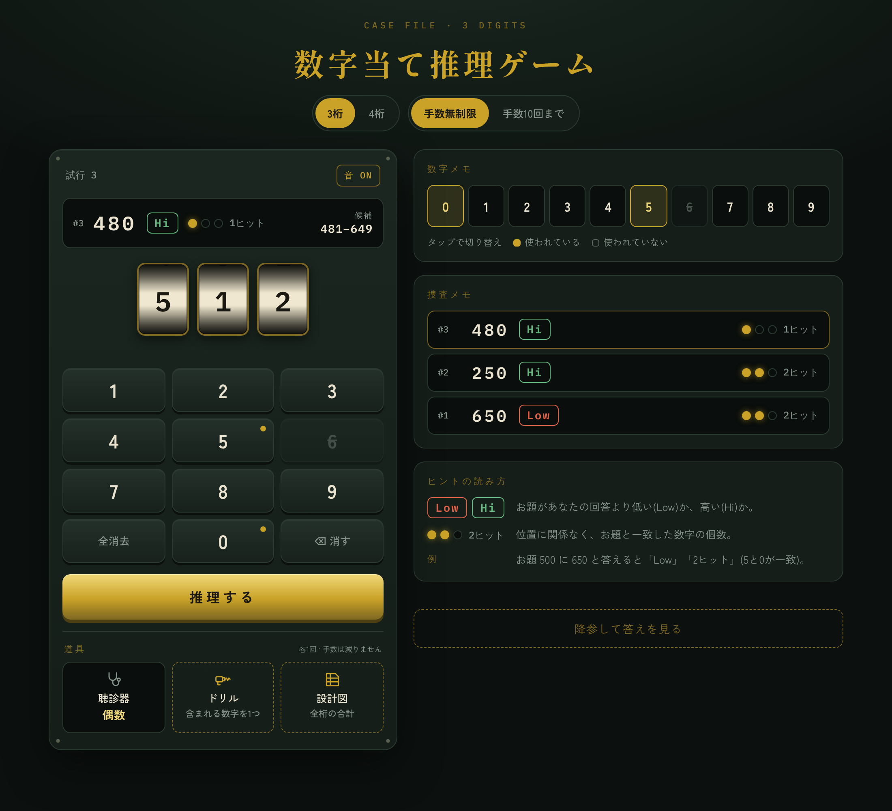

# 数字当て推理ゲーム

金庫の暗証番号(3桁または4桁)を、少ないヒントから推理して当てるブラウザゲームです。
回答するたびに「Low / Hi」と「何個の数字が合っているか」だけが返ってきます。



## 遊び方

1. 下のテンキーで数字を入力し、「推理する」を押します(パソコンなら数字キーと Enter でも入力できます)。
2. 返ってきたヒントをもとに、次の回答を考えます。
3. 暗証番号を当てれば開錠成功です。

### ヒントの読み方

| ヒント | 意味 |
| --- | --- |
| **Low** | お題は、あなたの回答より**低い** |
| **Hi** | お題は、あなたの回答より**高い** |
| **ヒット** | 位置に関係なく、お題と一致した数字の個数 |

**例:** お題が `500` のときに `650` と答えると、「Low」「2ヒット」(5 と 0 が一致)。

同じ数字が複数ある場合も、その個数まで正しく数えます(お題 `500` に `555` → 1ヒット)。

### 道具(各1回、手数は減りません)

| 道具 | わかること |
| --- | --- |
| 聴診器 | お題が奇数か偶数か |
| ドリル | お題に含まれる数字を1つ(位置はわからない) |
| 設計図 | 全桁の数字の合計 |

### モード

| モード | 内容 |
| --- | --- |
| 3桁 / 4桁 | お題は `000`〜`999` / `0000`〜`9999`(先頭が 0 のこともあります) |
| 手数無制限 / 手数制限 | 制限ありでは 3桁は10回、4桁は12回まで。使い切ると警報が鳴ってゲームオーバー |

### 推理を助ける機能

- **候補範囲:** これまでの Low / Hi から、お題がありうる範囲を表示します。
- **数字メモ:** 0〜9 をタップして「使われている / 使われていない」と印を付けられます。印はテンキーにも表示されます。
- **捜査メモ:** これまでの回答とヒントを一覧で振り返れます。

### 称号

クリアした手数に応じて称号が付きます。自己ベストはモードごとにブラウザに保存されます。

| 称号 | 3桁 | 4桁 |
| --- | --- | --- |
| 伝説の怪盗 | 5手以内 | 7手以内 |
| 名探偵 | 7手以内 | 9手以内 |
| 敏腕刑事 | 9手以内 | 11手以内 |
| 見習い探偵 | それ以上 | それ以上 |

## 起動方法

インストールやビルドは不要です。

- **パソコンで遊ぶ:** `index.html` をダブルクリックしてブラウザで開きます。
- **ネットに公開する:** GitHub Pages を使うと、URL を共有するだけで誰でも遊べます。
  1. このリポジトリを GitHub に push します。
  2. リポジトリの **Settings → Pages** を開きます。
  3. **Branch** で `main` と `/ (root)` を選んで **Save** を押します。
  4. 数分後に表示される URL を開くと遊べます。

> React などのライブラリとフォントをインターネット(CDN)から読み込むため、初回起動時はネット接続が必要です。

## 使っている技術

- **React 18:** 画面の表示と状態管理(CDN から読み込み)
- **Babel Standalone:** `index.html` に書いた JSX を、その場でブラウザが読める形に変換
- **Web Audio API:** 効果音(音声ファイルは使わず、その場で音を合成)
- **localStorage:** 自己ベストと効果音の ON / OFF を保存

## ファイル構成

```
.
├── index.html          ゲーム本体(HTML・CSS・JavaScript をこの1ファイルにまとめています)
├── README.md           このファイル
└── docs/
    └── screenshot.png  README 用のスクリーンショット
```

## 改造するときは

`index.html` の中の `<script type="text/babel">` 以下がゲームのプログラムです。調整しやすい箇所は次のとおりです。

| 変えたいもの | 探す場所 |
| --- | --- |
| 手数制限の回数 | `const LIMITS = { 3: 10, 4: 12 };` |
| 称号と必要な手数 | `const RANKS = { ... }` |
| 道具の名前と説明 | `const ITEMS = [ ... ]` |
| 色 | `const CSS` の中の `:root { --brass: ...; }` など |
